# Component Sets Architecture

This plugin decomposes the **Prompt Systems Architect** meta-prompt into **6 logical component sets** packaged as **14 modular `SKILL.md` units** under `skills/` (flat 1-level layout for native Antigravity plugin discovery). Each skill follows progressive disclosure: a terse operational `SKILL.md` plus swappable `references/`, `resources/`, and optional zero-dependency `scripts/`.

## Lifecycle & Dependency Map

```mermaid
flowchart LR
    subgraph CORE["Set 1: Core"]
        PA["prompt-architect (Orchestrator)"]
        WP["workflow-profile (State Contract)"]
        IN["intake-interviewer (Phase 1)"]
    end

    subgraph BUILD["Set 2: Build (Phase 2 A-C)"]
        PB["prompt-builder (2A)"]
        EB["evaluator-builder (2B)"]
        TB["testset-builder (2C)"]
    end

    subgraph ITERATE["Set 3: Iterate (Phase 3)"]
        ER["eval-runner (Score + Cluster)"]
        PR["prompt-refiner (Minimal Diff + Gate)"]
    end

    subgraph OPTIMIZE["Set 4: Optimize (2D + Phase 4)"]
        TA["token-auditor (2D + Ledger)"]
        TO["token-optimizer (Phase 4 Ablation)"]
    end

    subgraph DELIVER["Set 5: Deliver"]
        RP["release-packager (6-Part Release)"]
        DM["drift-monitor (Risks + Drift)"]
    end

    subgraph EXT["Set 6: Extensions (Overlays)"]
        MP["mode-policies (strict / lean)"]
        DP["domain-packs (code / cx / regulated)"]
    end

    PA --> WP
    PA --> IN
    IN -->|Build Gate Met| PB
    PB --> EB --> TB --> TA
    TA --> ER --> PR
    PR -->|Continue| ER
    PR -->|Stop Condition Met| TO
    TO <--> TA
    PR -->|Skip Phase 4| RP
    TO -->|Drop <= 0.1 & 0 HF| RP
    RP --> DM
    EXT -.->|Overlays| CORE
    EXT -.->|Overlays| BUILD
    EXT -.->|Overlays| OPTIMIZE
    EXT -.->|Overlays| DELIVER
```

---

## Component Set Catalog

### Set 1: Core — Kernel, State & Discovery
Owns global operating laws, session commands, shared state, and Phase 1 intake.

| Skill (`skills/<name>`) | Responsibility | Customizable Assets |
| :--- | :--- | :--- |
| `prompt-architect` | Master orchestrator, 10 operating rules, command router, pre-send check gate | `references/core-rules.md`, `references/commands.md` |
| `workflow-profile` | 9-field state contract, `Profile so far`, build gate, `profile: save/load`, risk calibration | `references/risk-tiers.md`, `resources/profile-template.yaml` |
| `intake-interviewer` | Phase 1 inference-first intake (`<= 5` MCQs/round, `★` defaults, shorthand replies) | `references/question-bank.md` |

### Set 2: Build — Phase 2 Artifact Authoring (A, B, C)
Produces the initial prompt, multi-layer evaluator, and balanced test suite. Each skill can run in sequence or standalone.

| Skill (`skills/<name>`) | Responsibility | Customizable Assets & Scripts |
| :--- | :--- | :--- |
| `prompt-builder` | Phase 2A: Static-first / variable-last Prompt v1, positive rules, `{{variables}}`, anti-fabrication fallback | `resources/prompt-blueprint.md` |
| `evaluator-builder` | Phase 2B: 4-7 criterion rubric (1/3/5 anchors), binary hard-fails, deterministic checks, blind strict-JSON judge | `resources/judge-prompt-template.md`, `references/deterministic-checks.md`, `scripts/run_deterministic_checks.py` |
| `testset-builder` | Phase 2C: 8-12 test cases (~50% typical, ~25% edge, ~25% adversarial) + `[REPLACE WITH REAL DATA]` flags | `resources/testset-template.md` |

### Set 3: Iterate — Phase 3 Empirical Refinement Loop
Scores runs (real or explicitly labeled `SIMULATED, verify with real runs`), diagnoses root causes, and applies minimal hypothesis-driven diffs.

| Skill (`skills/<name>`) | Responsibility | Customizable Assets & Scripts |
| :--- | :--- | :--- |
| `eval-runner` | Phase 3.1-3.3: `case x criterion` scoring, hard-fail gating, 5-category failure clustering | `references/failure-taxonomy.md`, `scripts/score_rubric.py` |
| `prompt-refiner` | Phase 3.4-3.6: Minimal edit set (no wholesale rewrites), `[edit] -> [failure] -> [effect]` changelog, regression check, stop condition | `resources/changelog-template.md` |

### Set 4: Optimize — Token Economics & Post-Stability Compression
Measures baseline tokens/costs in Phase 2D and compresses prompts, outputs, and runtime costs strictly **after** Phase 3 quality stability.

| Skill (`skills/<name>`) | Responsibility | Customizable Assets & Scripts |
| :--- | :--- | :--- |
| `token-auditor` | Phase 2D baseline + cross-version cost ledger (explicitly labeled approximate method + pricing assumptions) | `references/pricing-assumptions.md`, `scripts/estimate_tokens.py` |
| `token-optimizer` | Phase 4: 1-by-1 ablation, prompt & output compression, runtime levers (caching, tiering, batching, pre-filtering), `<= 0.1` drop / `0` HF gate | `references/compression-playbook.md` |

### Set 5: Deliver — Final Packaging & Production Monitoring
Compiles the 6-part production handoff and defines residual-risk / drift governance.

| Skill (`skills/<name>`) | Responsibility | Customizable Assets |
| :--- | :--- | :--- |
| `release-packager` | Compiles all 6 final deliverable sections into one consistent handoff artifact | `resources/release-package-template.md` |
| `drift-monitor` | Residual risks, deterministic telemetry, judge sampling cadence, re-eval triggers | `references/drift-signals.md` |

### Set 6: Extensions — Swappable Policy & Domain Overlays
Zero-touch customization layer: change behavior across the entire workflow without editing core skills.

| Skill (`skills/<name>`) | Responsibility | Customizable Assets |
| :--- | :--- | :--- |
| `mode-policies` | `balanced`, `strict`, `lean`, and custom org thresholds / budgets | `references/policy-presets.yaml` |
| `domain-packs` | Pluggable domain packs injecting intake defaults, hard-fails, adversarial tests & drift metrics | `references/code-and-structured.md`, `references/customer-facing.md`, `references/high-risk-regulated.md`, `references/custom-domain-template.md` |

---

## Customization Points (What to Edit, Where)

| What You Want to Customize | File to Edit | Core Skills Touched? |
| :--- | :--- | :---: |
| Enable/disable the full plugin globally | Toggle **Prompt Master** in Antigravity Customizations UI | None |
| Enable/disable skill subsets in a workspace | `.agents/skills.json` (or copy a manifest from `presets/`) | None |
| Change default stop thresholds (`low`/`medium`/`high`) | `skills/workflow-profile/references/risk-tiers.md` | None |
| Add team-specific intake MCQ questions | `skills/intake-interviewer/references/question-bank.md` | None |
| Adjust `strict` / `lean` tolerances or add org modes | `skills/mode-policies/references/policy-presets.yaml` | None |
| Add a new domain (e.g., e-commerce, HR, finance) | Copy `skills/domain-packs/references/custom-domain-template.md` | None |
| Set real provider model pricing & cache rates | `skills/token-auditor/references/pricing-assumptions.md` | None |
| Set production SLO alert thresholds & audit cadence | `skills/drift-monitor/references/drift-signals.md` | None |
